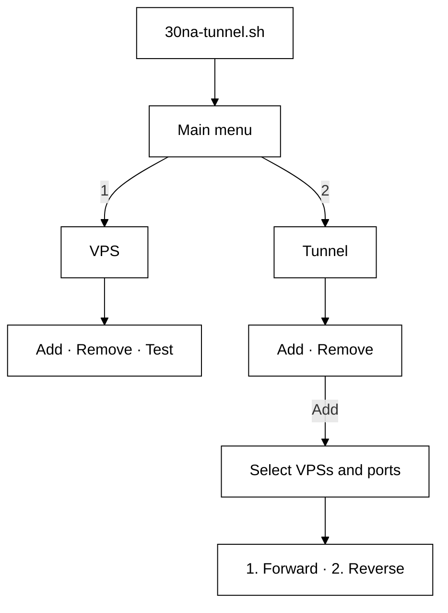

# SSH Tunnel Manager v2

Ubuntu terminal dashboard for managing OpenSSH TCP forwards with systemd. The
dashboard host holds the server registry and the listening ports. Forward
connections originate on the dashboard host. Reverse SSH connections originate
on the selected peer, with the SSH listener on the dashboard host and the TCP
target on the peer.

## Install on the dashboard host

Run as root on Ubuntu with systemd and nano. Place the encrypted
`30na-SSH-Backup.zip` at `/root/30na-SSH-Backup.zip`. The installer checks the ZIP and looks for
`/root/.30na-tunnel-passwords`. If absent, nano opens with
`zip-pass="Input Here"`. Replace the placeholder, then press Ctrl+X, Y, Enter.
After successful restore the password is saved on the server in a root-only
plaintext file (mode 0600) for subsequent installs. The pinned SSH Infrastructure 30nA installer validates the key pair and
restores it when absent. It keeps matching existing files and stops on a conflicting pair.
It registers the public key for root only if its fingerprint is absent from
`/root/.ssh/authorized_keys`, then loads the key and opens the installed dashboard.

```bash
clear
bash <(curl -fsSL https://raw.githubusercontent.com/sina1991/ssh-tunnel-manager/v2/reverse-tunnels/install.sh)
```

Open again with `sudo bash /opt/tunnel-manager/tunnel.sh`. The installer
preserves the existing server and forward databases and systemd units under
`/opt/tunnel-manager` and `/etc/systemd/system`. Existing forwards keep their
original units. A manually created reverse service must be stopped before
assigning its listener to the manager.

## Menu

- **Servers** — Add, Remove, Test SSH. Add verifies SSH access, installs the
  project and prerequisites on the peer, and saves the server after verification.
  First-time enrollment can require host-key verification and initial SSH
  authentication. Only the public key is registered on the peer. Regular
  dashboard-to-peer operations require key-based login. For unattended operations,
  the management key must work without an interactive SSH agent.
- **VPS Test** — Check SSH from this terminal to all registered VPSs, or test a
  temporary Forward or Reverse path between two distinct registered VPSs.
  Both VPSs must be manageable from the terminal and the initiating VPS
  must already trust and authenticate to the other over SSH. The temporary
  listener binds to loopback. Enter selects a free local port and remote port
  22, respectively. The remote port is the service port, not the SSH port
  setting. The temporary SSH process expires after 12 seconds.
- **Tunnels** — Add, Remove, and Tunnel Test. Tunnel Test checks all active
  tunnels. New tunnels start immediately and at boot. Use the dashboard host's public IPv4
  address as the listen address if it is assigned to an interface and the listener
  must accept external connections. Permit the chosen TCP port in your firewalls.
  The TCP target is `127.0.0.1` on the selected peer.
- **Remove server** — Removes every managed tunnel for the peer before removing
  the server record. If cleanup fails, the server remains registered so the
  operation can be retried.

Reverse setup generates a key on the peer and installs a restricted SSH account
on the dashboard host for that tunnel. The account permits one remote listener
and has no shell sessions. The peer pins the dashboard host's Ed25519 host key.
Custom sshd policies must allow public-key login for that account and load
`/etc/ssh/sshd_config.d/*.conf`. The SSH daemon is validated before reload.

## Checks

The dashboard separates service state from the last connection test. The timer
runs every 30 minutes. Tunnel Test checks active tunnels of both types and continues
after a failure. Manual tests report SSH, listener, and TCP path. TCP path
testing opens the listener and checks for a new established loopback socket at
the target while holding the connection. This probe expects services that leave
the TCP session open long enough to observe and can be affected by simultaneous
new connections. Test application authentication, external firewall reachability
and VPN egress from the actual client.

```bash
systemctl status tunnel-health-check.timer --no-pager
journalctl -u tunnel-health-check.service -n 50 --no-pager
```

## 30nA-TUNNEL v2.0.0 — راهنمای کاربر

این بخش طرح تأییدشدهٔ CLI است. نمونه‌ها رفتار مورد انتظار نسخهٔ `30na-tunnel.sh`
را نشان می‌دهند. برای نصب و اجرای نسخهٔ فعلی از بخش Install بالا استفاده کن.



### ۱. صفحه اصلی

با هر انتخاب، صفحه پاک می‌شود و وضعیت VPSها و تونل‌های فعال بالای صفحهٔ بعدی
دوباره نمایش داده می‌شود. نمونه‌های بعدی فقط بخش پایین صفحه را نشان می‌دهند.

```text
30nA-TUNNEL v2.0.0

STATUS
HOST             VPS         IP              DNS CHECK
i.30na.top       vps-56001   91.216.217.244   OK (09:42)

VPS
ID   HOST             SSH
1    i.30na.top       LOCAL
2    gr02.30na.top    OK
3    uk5.30na.top     OK

ACTIVE TUNNELS
ID   MODE      LISTEN      TARGET
1    Forward   IRAN:443    UK5:443
2    Forward   IRAN:4443   UK5:443
3    Forward   IRAN:6677   UK5:443

1. VPS
2. Tunnel
0. Exit

Select > 1
```

### ۲. منوی VPS

```text
VPS
1. Add New VPS
2. Remove VPS
3. VPS Test
0. Back

Select > 3
```

**Add New VPS** دامنه یا IP را می‌گیرد، با `root` متصل می‌شود، پروژه را روی VPS
نصب می‌کند و شمارهٔ ثبت‌شده را نشان می‌دهد.

```text
ADD NEW VPS
VPS address [e.g. gr02.30na.top] > gr02.30na.top
SSH from this terminal: OK
30nA-TUNNEL installation: OK
VPS ID: 2
```

**Remove VPS** با شناسهٔ VPS، تونل‌های وابسته و سپس رکورد VPS را حذف می‌کند.
اگر حذف تونلی خطا بدهد، شناسهٔ آن نمایش داده می‌شود و رکورد VPS برای تلاش مجدد
باقی می‌ماند.

```text
REMOVE VPS
2. gr02.30na.top
3. uk5.30na.top
0. Back

VPS ID > 2
Removed VPS 2 and its associated tunnels.
```

**VPS Test** دو گزینه دارد. گزینهٔ اول SSH همهٔ VPSها را از همین ترمینال
بررسی می‌کند. گزینهٔ دوم با انتخاب شمارهٔ Local VPS و Remote VPS، پورت‌ها و
Mode، یک تونل آزمایشی می‌سازد. اگر پورت Local را خالی بگذاری، یک پورت آزاد
انتخاب می‌شود. پیش‌فرض پورت سرویس Remote برابر `22` است.

### ۳. منوی Tunnel

```text
TUNNEL
1. Add Tunnel
2. Remove Tunnel
3. Tunnel Test
0. Back

Select > 1
```

**Add Tunnel** ابتدا شمارهٔ دو VPS و دو پورت را می‌گیرد و سپس حالت را می‌پرسد.
**Local VPS** محل پورت ورودی کاربران است و **Remote VPS** میزبان سرویس مقصد
است. `Mode` مشخص می‌کند کدام VPS اتصال SSH را آغاز کند.

```text
ADD TUNNEL
1. IRAN  i.30na.top
2. GR02  gr02.30na.top
3. UK5   uk5.30na.top
0. Back

Local VPS ID > 1
Remote VPS ID > 2
Local port [e.g. 18443] > 18443
Remote port [e.g. 443] > 443
Mode [1. Forward / 2. Reverse] > 2

Tunnel created: 4
Listener: IRAN:18443
Target:   GR02:443
Mode:     Reverse (SSH starts on GR02)
Status:   UP
```

| Mode | جهت اتصال SSH | مسیر ترافیک کاربر |
|---|---|---|
| `1. Forward` | Local VPS → Remote VPS | Local Port → Remote Port |
| `2. Reverse` | Remote VPS → Local VPS | Local Port → Remote Port |

در مثال Reverse، کاربر به `i.30na.top:18443` وصل می‌شود و ترافیک به
Xray روی `GR02:443` می‌رسد. برای نمونهٔ Forward به UK5، شمارهٔ Local را `1`،
شمارهٔ Remote را `3` و Mode را `1` انتخاب کن.

**Remove Tunnel** فهرست شماره‌دار تونل‌ها را نشان می‌دهد و تونل انتخاب‌شده
را حذف می‌کند.

```text
REMOVE TUNNEL
1. Forward   IRAN:443     → UK5:443
2. Forward   IRAN:4443    → UK5:443
3. Forward   IRAN:6677    → UK5:443
4. Reverse   IRAN:18443   → GR02:443
0. Back

Tunnel ID > 4
Tunnel 4 removed.
```

**Tunnel Test** همهٔ تونل‌های فعال را بررسی می‌کند.
